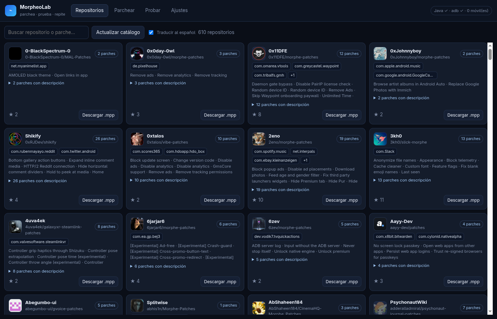

# MorpheoLab

Aplicación de escritorio (Electron) para **parchear APKs con Morphe y probarlas en el móvil**, todo desde el PC.

> Código propio (MIT). No incluye binarios de Morphe: se descargan con un script.

## Qué hace

- **Repositorios**: carga el índice de [morphe-patches.software](https://morphe-patches.software/)
  (610+ bundles de la comunidad) con **icono de cada bundle**, apps objetivo (paquetes),
  número de parches, estrellas y la **lista desplegable de parches con su descripción**.
  Buscador por repo, app o parche, y descarga del `.mpp` de la última release.
- **Traducción al español** de las descripciones de parches, con un traductor local (Ollama) y caché.
- **Parchear**: elige el APK (`.apk/.apkm/.xapk/.apks`), los parches y aplica Morphe Desktop.
- **Probar**: instala el APK parcheado con `adb`, detecta el paquete, lo lanza, hace captura de
  pantalla y saca `logcat` contando `FATAL EXCEPTION`.
- **Menú en español** y avisos legales integrados.



## Requisitos

- Node.js 20+ y Electron (se instala con npm)
- Java 17+ (`java -version`)
- Android platform-tools (`adb`)
- Móvil Android con **depuración USB** activada (para la pestaña *Probar*)

## Instalación

```bash
npm install
./scripts/instalar-morphe.sh        # baja morphe-desktop.jar y patches.mpp
npm start                           # o ./start.sh
```

## Uso

1. **Repositorios** → busca la app que quieras y pulsa *Descargar .mpp*.
2. **Parchear** → elige el APK, revisa los parches y pulsa *Parchear*.
3. **Probar** → *Instalar*, *Lanzar*, *Captura*, *Logcat*.

## Aviso legal

- Usa esto **solo con aplicaciones que hayas instalado/comprado tú**.
- **No publiques APKs parcheados**: son software propietario modificado y su distribución infringe derechos de autor.
- Sí puedes publicar tus propios bundles de parches (`.mpp`) y tus informes de prueba.
- Morphe Desktop y los parches son proyectos de terceros ([MorpheApp](https://github.com/MorpheApp)).

## Licencia

MIT para el código de MorpheoLab.
